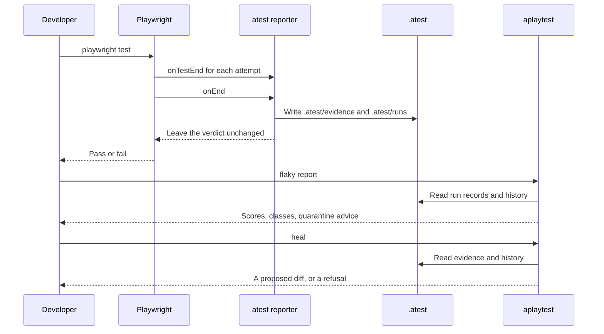
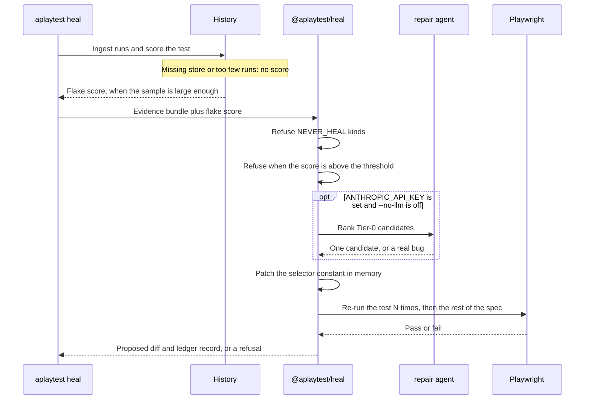
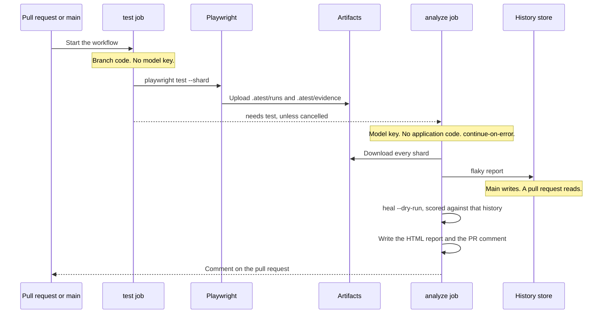

# aplaytest

A control plane around Playwright for flake scoring, selector heals, and impact analysis — without putting a language model in the pass/fail path.

## Features

- **Evidence, not screenshots-only** — every failure records ARIA, test ids, network/console, and the failing page-object call.
- **Deterministic flake engine** — recency-weighted scores, classification, bisect, quarantine budget and expiry. No model required.
- **Heals as git patches** — candidates from the page’s own test ids; Playwright re-runs decide. Schema and app errors are never healed.
- **Impact analysis** — static import graph plus route coverage, with a reason for every selected spec.
- **LLM never in CI pass/fail** — tests stay `playwright test`. Heals and authoring are offline; missing an API key degrades scope, not correctness.

## Quick Start

**Prerequisites:** Node.js 22+, an existing Playwright suite.

**Installation:**

```sh
npm i -D @aplaytest/cli @aplaytest/runner-playwright
npx aplaytest init --apply
```

`init` adds the reporter to `playwright.config.ts` and a `.gitignore` block. Omit `--apply` to preview the diff. Undo with `npx aplaytest init --undo --apply`.

**Usage:**

```sh
npx playwright test
npx aplaytest doctor
npx aplaytest flaky report
npx aplaytest heal --spec tests/example.spec.ts
npx aplaytest impact --from origin/main
```

Run the suite as usual. Failures land in `.atest/evidence` and `.atest/runs`. CLI surface: `npx aplaytest --help`. Design: [docs/README.md](./docs/README.md).

## How a run is recorded

Playwright still discovers and runs the tests. The reporter collects each attempt and writes evidence after the run. It does not change the pass or fail result. Scoring and healing are later commands.



The same picture is in [docs/01-architecture.md](docs/01-architecture.md#run-flow).

## How a heal is proposed

`aplaytest heal` reads a captured failure and asks `@aplaytest/heal` for a patch. It scores the same history store as `flaky report` and passes that score in. Schema, application, and network failures stop immediately. A score above the threshold stops immediately too. A missing store, or fewer runs than `minRuns`, leaves the score unset and that gate stays shut. A model, when a key is set, may only rank candidates the deterministic tier already found. Playwright re-runs the test before a patch counts as proposed. `--dry-run` skips that re-run and says so.



The same picture is in [docs/05-healing.md](docs/05-healing.md#heal-flow).

## CI flow

`aplaytest ci generate` writes three jobs: test, analyze, and policy. The test job runs the branch and has no model key. The analyze job holds the key, runs no application code, and continues on error. Main writes the history store. A pull request opens it read-only. Heal in that job is scored against the same store. Policy runs `flaky expire --ci` and can fail the workflow.



The same picture is in [docs/08-cicd.md](docs/08-cicd.md#ci-flow).

## Configuration

Every field in `atest.config.ts` is optional; empty means `mode: 'strict'` and propose-only healing.

```ts
import { defineAtestConfig } from '@aplaytest/core';

export default defineAtestConfig({
  mode: 'strict',
  heal: { apply: 'propose' },
});
```

| Variable | Purpose |
| --- | --- |
| `ATEST=0` | Disable the reporter entirely |
| `ATEST_HISTORY_URL` | History store (`path`, `azblob://…`, or `:memory:`) |
| `ANTHROPIC_API_KEY` | Optional model tier. Unset = deterministic engines only |

Full list: [`.env.example`](./.env.example). Azure history: `npm i -D @aplaytest/store-azure`.

## Contributing

Issues and PRs are welcome. See [CONTRIBUTING.md](./CONTRIBUTING.md). Report vulnerabilities via [security advisories](https://github.com/ianoflynnautomation/aplaytest/security/advisories/new), not a public issue.

## License

[MIT](./LICENSE)
