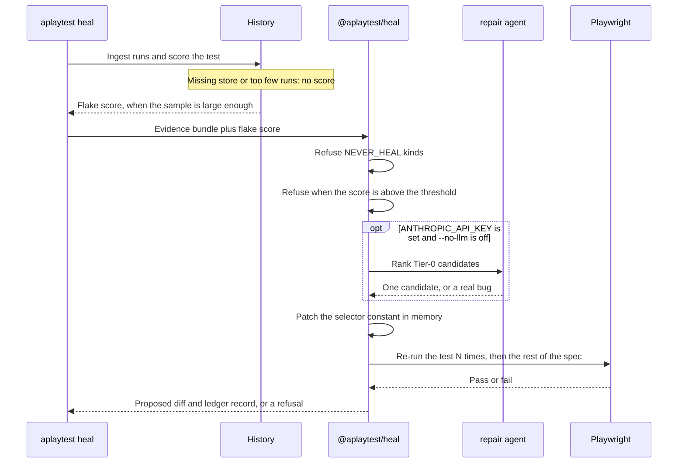

# 05 — Auto-healing engine

## The thesis

Most "self-healing test" products swap a selector at runtime and let the test go green.
That trades a loud, cheap failure for a silent, expensive one: the repo now claims to
test something it does not, and nobody finds out until a real bug slips through.

`atest` inverts it. Healing is an **offline code-change proposal pipeline**:

> A failure produces a candidate patch. Playwright validates the patch. A human (or an
> explicit policy) merges it. The heal is recorded, diffable, and revertible.

The test still fails in the run where the breakage happened. That is the point.

## Heal flow

`aplaytest heal` reads a captured failure and asks `@aplaytest/heal` for a patch. It scores the same history store as `flaky report` and passes that score in. Schema, application, and network failures stop immediately. A score above the threshold stops immediately too. A missing store, or fewer runs than `minRuns`, leaves the score unset and that gate stays shut. A model, when a key is set, may only rank candidates the deterministic tier already found. Playwright re-runs the test before a patch counts as proposed. `--dry-run` skips that re-run and says so.



The same picture is in the [README](../README.md#how-a-heal-is-proposed). The decision detail is below.

---

## Decision flow

`proposeHeal` in `packages/heal/src/propose.ts` runs these gates in order. A later gate does not run after an earlier one refuses.

```
failure + EvidenceBundle
        │
        ▼
NEVER_HEAL, or the kind is not healable? ── yes ──► refused-never-heal
        │
        no
        ▼
flake score is set and above the threshold (default 0.15)? ── yes ──► refused-flaky
        │
        no
        ▼
assessBundle ── ineligible ──► refused-ineligible
        │
        eligible
        ▼
generateCandidates
  strategies: testid, role, label, text
        │
        none within maxDistance ──► no-candidates
        │
        ▼
optional ranker picks one generated candidate, or marks a real bug
        │
        real bug ──► refused-never-heal
        │
        ▼
patchConstant ── no source ──► no-constant
        │
        ▼
--dry-run ──► proposed, and the reason says NOT VALIDATED
        │
        otherwise
        ▼
validateHeal: re-run the target N times (default 3), then the rest of the spec
        │
        pass ──► proposed
        fail ──► rejected
```

The CLI opens the same history store as `flaky report` (`--db`, then `ATEST_HISTORY_URL`, then `:memory:`), ingests `--runs`, and passes a score only when the sample meets `minRuns`. A missing runs directory leaves the score unset, and the flake gate stays shut. A young test is not treated as a measurement.

**A known flake is refused before any candidate is generated.** Healing a flake is a permanent code change made to chase noise. The flake continues, and the selector is wrong as well. Flaky and broken are different problems, and the engine decides which one it is first.

**Validation is a re-run.** The model's choice orders the candidates. Playwright decides. `--dry-run` skips the re-run and labels the proposal `NOT VALIDATED`.

---

## Tier 0 — deterministic candidate generation

`generateCandidates` is synchronous. It reads the evidence bundle. It does not open a history store and it does not drive a browser.

The default strategies are `testid`, `role`, `label`, and `text` (`DEFAULT_CANDIDATE_OPTIONS.allowedStrategies`). `css` and `xpath` stay out. For a single missing test id, every other id on the page is scored by token-aware distance and kept when `semanticDistance` is within `maxDistance` (default 0.4) and the stability rank is within `minStabilityRank` (default 4, which still allows text). For a role, label, or text locator, other accessible names are taken from the ARIA snapshot.

The score only orders that list:

```
score = 0.7 * (1 - semanticDistance)
      + 0.3 * (1 - stabilityRank / minStabilityRank)
```

The ranker, when a key is set, may choose one of those candidates, or it may say the failure is an application defect. It does not invent a selector. Playwright's re-run is what accepts a patch.

### Stability ranking

```ts
export const STABILITY_RANK = {
  testid: 0, role: 1, label: 2, placeholder: 3, text: 4, css: 5, xpath: 6,
} as const;
```

**A heal that lowers the stability class is a warning, not a win.** Replacing a testid
with `getByText('Blackwater Valley BJJ')` makes the test pass and makes it worse — it
now breaks on any copy change and couples the test to seeded content. Policy:

- `stabilityDelta < 0` → never auto-applied, always human-reviewed, flagged in the PR.
- `stabilityRank > config.heal.minStabilityRank` (default 4) → rejected outright. **No
  auto-generated XPath, ever.** If nothing better exists, the correct output is
  "the app needs a `data-testid`" — which is a genuinely useful thing for the tool to
  say, and something your app repo can act on.

### Scoring

```ts
score = 0.40 * (1 - semanticDistance)     // does it mean the same thing?
      + 0.25 * (1 - stabilityRank / 6)    // is it a durable address?
      + 0.15 * uniquenessConfidence       // matchCount===1 and stable across reload
      + 0.10 * proximityToOriginal        // same container / nearby in the ARIA tree
      + 0.10 * historicalAgreement        // has this exact heal been accepted before?
```

`historicalAgreement` compounds: once a `gym-card-name → gym-card-title` rename is
accepted, the same rename in `events`, `stores`, and `competitions` is resolved with
high confidence and no model call. Renames in this app are systematic, so the first
heal effectively teaches the rest.

---

## Three strategies, three risk levels

### 1. Selector healing — the default, auto-applicable

Target: `src/ui/pages/<feature>/<feature>.constants.ts`. Applied with **ts-morph**, not
text replacement, so it understands `as const` object literals, updates every property
holding the same literal, and never corrupts the file.

```ts
export async function applySelectorHeal(proposal: SelectorProposal, project: Project): Promise<Patch> {
  const file = project.getSourceFileOrThrow(proposal.targetFile);
  const targets = findConstantAssignments(file, proposal.before);  // may be >1

  for (const t of targets) t.setInitializer(JSON.stringify(proposal.after));

  // gyms.constants.ts holds 'gym-card-name' in BOTH TEST_IDS.cardName and
  // GYM_CARD_TEST_IDS.name — a text-level patch would fix one and leave the other.
  return {
    diff: file.getFullText(),
    touchedConstants: targets.map(t => t.getName()),
    warnings: targets.length > 1 ? [`updated ${targets.length} constants sharing this literal`] : [],
  };
}
```

### 2. Flow healing — Tier 2, default OFF

An alternative path to the same goal: the county filter moved behind a "Filters" drawer
on mobile, so the flow needs an extra click. Genuinely useful, genuinely dangerous —
it changes what the test *does*, and therefore may change what it *proves*.

Rules:
- Enabled only via `--strategies flow` or `aggressiveness: aggressive`.
- **Never auto-applied.** Human review, always.
- The proposal must state which assertions are unaffected, and the validator re-runs the
  full spec file with `--repeat-each 3`.
- The PR description must contain a "what this changes about coverage" section.

### 3. Assertion healing — propose-only, permanently

An assertion heal that makes red go green is operationally indistinguishable from
deleting the test. It is offered because assertion drift is real and common, but it is
never automatic.

Requirements for an assertion proposal to even be surfaced:

1. `appChangeEvidence` must be non-empty — a linked app-repo commit, a changed API
   response captured in the bundle, or a spec/schema diff. "The value is different now"
   is not evidence; it is the failure restated.
2. It is rendered as a **question**, not a patch: *"Did the OpenMat badge intentionally
   change from `EVENT` to `OPEN MAT`?"*
3. `config.heal.apply` is ignored — assertion heals are always `propose`.

The textbook case is a mapper that still emits `'EVENT'` because the fix exists in the
app but is not deployed. Both `'EVENT'` and `'OPEN MAT'` are "correct" depending on
which build is running. No amount of page inspection resolves that; it requires
knowing a deploy is pending. Which is exactly why a human decides.

---

## Validation harness

```ts
export async function validateHeal(
  proposal: HealProposal, ctx: HealContext,
): Promise<ValidationRecord> {
  // Scratch git worktree — the developer's working tree is never touched during
  // validation, so a failed heal cannot leave debris.
  const wt = await ctx.git.createScratchWorktree(`atest-heal-${proposal.id}`);
  try {
    await applyPatch(wt, proposal.patch);

    const types = await run(wt, 'npm run typecheck');
    if (!types.ok) return reject('typecheck_failed', types);

    const lint = await run(wt, `npx eslint ${proposal.patch.files.join(' ')}`);
    if (!lint.ok) return reject('lint_failed', lint);

    // The failing test must now pass EVERY time. One flake here means the heal is
    // unproven, not "mostly working".
    const target = await runPlaywright(wt, {
      file: proposal.testFile, grep: proposal.testTitle,
      project: proposal.project, repeatEach: ctx.config.heal.validationRuns,
    });
    if (target.failed > 0) return reject('target_still_failing', target);

    // Collateral: other tests in the file share the constants file we just edited.
    if (ctx.config.heal.validateCollateral) {
      const file = await runPlaywright(wt, { file: proposal.testFile, project: proposal.project });
      if (file.failed > 0) return reject('collateral_damage', file);
    }

    return { status: 'validated', runs: ctx.config.heal.validationRuns, ...summarize(target, file) };
  } finally {
    await ctx.git.removeWorktree(wt);
  }
}
```

`collateral_damage` is the check that catches the seductive-but-wrong heal. Retargeting
`TEST_IDS.cardName` to a container element can make one assertion pass while quietly
breaking `readCard()` for the other nine tests in `gyms.ui.acceptance.spec.ts`.

---

## Ledger, versioning, rollback

Every proposal — accepted or not — writes `.atest/heals/<healId>.json`, **tracked in
git**. The ledger is the audit trail, and it belongs in the repo alongside the change it
justifies.

```json
{
  "healId": "heal_2f81c0",
  "createdAt": "2026-08-16T14:07:03Z",
  "atestVersion": "0.4.1",
  "promptVersion": "repair@3",
  "evidenceId": "ev_9f3a21",
  "traceId": "4bf92f3577b34da6a3ce929d0e0e4736",
  "test": { "id": "a1b2c3", "title": "Given a gym name, when a visitor searches, …",
            "file": "tests/features/gyms/gyms.ui.acceptance.spec.ts", "project": "chromium-desktop" },
  "failureKind": "locator_not_found",
  "strategy": "selector",
  "diagnosis": "selector_renamed",
  "patch": {
    "file": "src/ui/pages/gyms/gyms.constants.ts",
    "constants": ["TEST_IDS.cardName", "GYM_CARD_TEST_IDS.name"],
    "before": "gym-card-name",
    "after": "gym-card-title",
    "stabilityDelta": 0
  },
  "tier": 1,
  "model": "claude-sonnet-5",
  "confidence": 0.94,
  "usage": { "inputTokens": 4102, "outputTokens": 210, "usd": 0.014 },
  "candidatesConsidered": 4,
  "validation": { "status": "validated", "runs": 3, "targetPassed": 3,
                  "collateralPassed": 9, "typecheck": true, "lint": true },
  "status": "applied",
  "reviewedBy": "<github-handle>",
  "revertPatch": "…unified diff…"
}
```

- `aplaytest heal revert heal_2f81c0` applies `revertPatch` and marks the row `reverted`.
- `aplaytest heal list --status reverted` surfaces heals that were wrong — the feedback
  signal for prompt and scoring evaluation.
- Reverted heals decay `historicalAgreement`, so a bad pattern stops being confidently
  repeated.

---

## Aggressiveness levels

| Level | Strategies | Min stability | Validation runs | Apply | Where |
| --- | --- | --- | --- | --- | --- |
| `off` | — | — | — | — | Anywhere heals are unwanted |
| `conservative` | testid, role | 1 (role or better) | 5 | propose | Regulated / high-stakes suites |
| `balanced` ★ | testid, role, label, text | 4 | 3 | PR | **Default** |
| `aggressive` | + flow, + assertion proposals | 4 | 3 | local apply | Developer inner loop only |

Guards that hold at every level, including `aggressive`:

- `NEVER_HEAL` failure kinds are never healed.
- Assertion heals are never auto-applied.
- Locators below the stability floor are never generated.
- No heal is accepted without a full validation pass.
- `aggressive` is refused in CI (`process.env.CI` → hard error, exit 4).

## Expected effectiveness

Honest estimates, so success can be measured rather than assumed:

| Failure cause | Tier 0 alone | Tier 0 + Tier 1 |
| --- | --- | --- |
| testid renamed | ~85% | ~95% |
| element moved, id intact | ~90% | ~95% |
| element replaced, new semantics | ~15% | ~55% |
| ambiguous match (new duplicate) | ~40% | ~75% |
| element genuinely removed | 0% (correct — it is a real change) | 0% |

Track `heals proposed / accepted / reverted` as the framework's own KPI. A rising revert
rate is the signal to lower aggressiveness — and the reason the ledger records enough to
notice.
