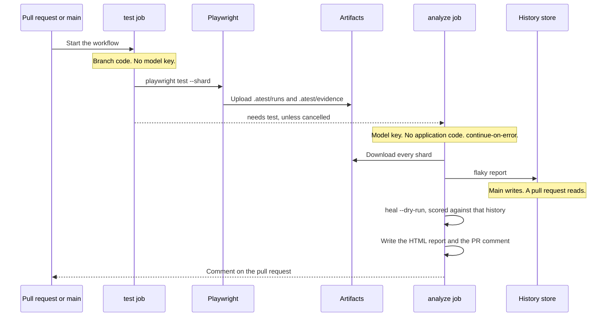

# 08 — CI/CD

> **`aplaytest run` does not exist, and deliberately.** Tests are invoked with
> `playwright test` exactly as before; atest attaches through the reporter.
> A wrapper would contradict the design's own claim that removing the reporter
> line removes the framework, and would owe permanent exit-code parity for no
> capability. Earlier drafts of this document showed `aplaytest run`; those have
> been corrected.
>
> Persisting history across runs needs a durable store — see
> [12 — Azure history](./12-azure-history.md). `:memory:` (the default)
> reports "insufficient data" forever, which reads as the engine working.

## CI flow

`aplaytest ci generate` writes three jobs: test, analyze, and policy. The test job runs the branch and has no model key. The analyze job holds the key, runs no application code, and continues on error. Main writes the history store. A pull request opens it read-only. Heal in that job is scored against the same store. Policy runs `flaky expire --ci` and can fail the workflow.



The same picture is in the [README](../README.md#ci-flow). The generator that emits this shape is `packages/cli/src/commands/ci.ts`.

## The central constraint: split execute from analyze

The test job executes application code and, on `pull_request`, code from a fork. The
analyze job holds a model API key. **These must not be the same job.**

Why this matters concretely, and not as generic hygiene:

1. **Secret exposure.** A PR that modifies a spec, a fixture, or `playwright.config.ts`
   runs arbitrary code in the test job. If `ANTHROPIC_API_KEY` were in that job's env, a
   one-line change exfiltrates it. Your repo already runs zizmor with a SHA-pinning
   policy; this is the same class of concern one level up.
2. **Determinism.** The merge gate must be reproducible. If the job that decides
   pass/fail can call a model, it is not.
3. **Cost control.** Analyze runs once per workflow, not once per shard. With a 9-shard
   matrix that is a 9× difference.
4. **Failure isolation.** A model provider outage must not turn a red build into an
   infrastructure incident. Analyze is `continue-on-error: true`.

---

## GitHub Actions — `atest.yml`

`npx aplaytest ci generate` writes `.github/workflows/atest.yml`. The generator is `packages/cli/src/commands/ci.ts`. It emits three jobs. The default Playwright image is `mcr.microsoft.com/playwright:v1.64.1-noble`; `--playwright-image` overrides it. Keep that tag on the same Playwright version the suite pins.

**test.** Runs `npx playwright test --shard`. Uploads `.atest/runs` and `.atest/evidence`. The job has no model key and no secrets. Shards share `ATEST_RUN_ID`.

**analyze.** `continue-on-error: true`. Holds `ANTHROPIC_API_KEY`. Downloads the shard artifacts and does not run application code. The job environment sets `ATEST_HISTORY_URL` from `vars.ATEST_HISTORY_ACCOUNT`: `azblob://<account>/atest-history` on main, and the same URL with `?readonly=1` on a pull request or any other branch. An empty account leaves the URL empty, and the CLI falls through to `:memory:`.

The steps are:

- `npx aplaytest flaky report --runs .atest-artifacts/runs`
- `npx aplaytest heal --evidence .atest-artifacts/evidence --runs .atest-artifacts/runs --dry-run`
- `npx aplaytest report`, writing the HTML report and the pull-request comment
- on main, `npx aplaytest history prune --keep-days 90` against the writable store
- on a pull request, one updating comment via `gh pr comment --edit-last`

Heal and the flaky report share that history URL, so a score above the threshold refuses the heal before any candidate is generated. `--dry-run` writes nothing to the working tree.

**policy.** Runs `npx aplaytest flaky expire --ci`. This job is not `continue-on-error`. An expired quarantine fails the workflow.

Impact selection is `npx aplaytest impact`. The generator does not emit a plan job.

`test` is the merge gate. `analyze` is best-effort. `policy` is where quarantine hygiene can block a merge.

---

## History storage in CI

The history store must survive between runs. Three options; start with the first.

### Option A — orphan branch (recommended to start)

```bash
aplaytest history export --to-branch atest-history --push
```

An orphan branch `atest-history` holding `history.sqlite` (plus a JSONL fallback for
mergeability). Zero infrastructure, works on any GitHub plan, versioned by construction,
and `git log` on that branch is a free audit trail.

Concurrency is handled by a dedicated GitHub concurrency group with
`cancel-in-progress: false`, so exports serialise. Only `main` writes; PRs read.

Practical limit: roughly 100k attempts / ~50 MB. For this suite — 271 tests × 11 projects
× ~20 runs/week ≈ 60k attempts/quarter — with a 90-day prune that is comfortable for a
long time.

### Option B — Postgres

Same schema, `history.driver = 'postgres'`. Switch when you want cross-repo dashboards,
sub-second leaderboard queries over years of data, or writes from multiple repos.

### Option C — S3/blob + DuckDB

Parquet partitioned by date, queried with DuckDB. Best analytics story, most operational
work. Only worth it at large scale.

**Do not** store history in the Playwright HTML report or in artifacts alone — artifacts
expire, and a history store with a 7-day memory cannot detect flake.

---

## GitLab CI

`npx aplaytest ci generate --provider gitlab` writes `.gitlab-ci.atest.yml`. The stages are `test`, `analyze`, and `policy`.

**test** uses the same Playwright image, runs `npx playwright test --shard`, and publishes `.atest/runs` and `.atest/evidence`.

**analyze** is `allow_failure: true` and holds `ANTHROPIC_API_KEY`. It runs:

- `npx aplaytest flaky report --runs .atest/runs`
- `npx aplaytest heal --evidence .atest/evidence --runs .atest/runs --dry-run`
- `npx aplaytest report --runs .atest/runs --evidence .atest/evidence --out report.html`

Each command is its own process. Both the flaky report and heal ingest `.atest/runs`, so the flake gate sees this pipeline's history. A durable store is `ATEST_HISTORY_URL` on the job, the same variable the GitHub job sets.

**policy** runs `npx aplaytest flaky expire --ci`.

---

## Test impact analysis

Deterministic, two-source, with an explicit escape hatch. No model in the common path.

### Source 1 — static import graph

`ts-morph` builds the closure from each spec through its imports. In this repo the edges
are unusually clean because of the path aliases and the feature-slice layout:

```
gyms.ui.acceptance.spec.ts
  → @ui/fixtures            → gyms.fixture.ts → gyms.page.ts → gyms.constants.ts
                                              → gyms.mock.ts → json-response.mock.ts
  → @ui/pages/gyms/gyms.card.mapper
  → tests/testdata/seeded/gyms.ts → @api/features/gyms/gyms.types
```

A change to `src/ui/pages/gyms/gyms.constants.ts` therefore selects exactly the specs
that transitively import it. `src/shared/config/**` reaches everything, and is correctly
treated as a full-suite trigger.

### Source 2 — runtime coverage map

Harvested from Playwright traces during `--record-coverage`: which routes each test
visited, which testids it resolved, which API paths it called. This catches edges the
import graph cannot see — `routes.a11y.acceptance.spec.ts` iterates routes from an array
and never imports `gyms.page.ts`, but its coverage map records `/gyms`.

### Selection rules

```ts
export function selectTests(changed: string[], graph: ImportGraph, cov: CoverageMap): Selection {
  // Any of these means: run everything. Cheap insurance against a clever-but-wrong
  // selection silently reducing coverage.
  const FULL_SUITE_TRIGGERS = [
    'package.json', 'package-lock.json', 'playwright*.config.ts',
    'src/shared/**', 'atest.config.ts', '.github/workflows/**', 'Dockerfile',
  ];
  if (changed.some(p => matchesAny(p, FULL_SUITE_TRIGGERS))) return Selection.full('trigger');

  const byImport   = graph.dependentsOf(changed);
  const byCoverage = cov.testsTouching(routesFor(changed));
  const alwaysRun  = graph.testsTagged('@smoke');   // smoke is never skipped

  const selected = union(byImport, byCoverage, alwaysRun);

  // If we would run most of it anyway, the bookkeeping is not worth the risk.
  if (selected.size > graph.allTests.size * 0.6) return Selection.full('threshold');

  return Selection.of(selected, { reasons: explain(byImport, byCoverage) });
}
```

Non-negotiable guards:

- **`main` always runs everything.** Impact analysis is a PR-latency optimisation only.
- **`@smoke` always runs.** 28 tests, ~18s. It is the floor.
- **Above 60% selection, run everything.** The savings do not justify the risk.
- **Every selection is explained.** `aplaytest impact --format list` prints, per test, the
  edge that selected it. A selection nobody can explain is a coverage hole waiting to
  happen.

### Cross-repo (the interesting hard case)

A change in the application repo (`GymCard.tsx`) has no import edge into the test
repo. Two
mechanisms, in order:

1. **Testid diff (deterministic).** Extract `data-testid` literals from the app diff,
   look them up in the coverage map and in `*.constants.ts`. A renamed testid selects
   exactly the affected tests. This handles most real cases with no model.
2. **Route/component mapping (model-assisted).** If the app diff touches files with no
   testid signal, ask a model to map changed component paths to app routes, then select
   by route from the coverage map. Result is cached per app-commit and **never narrows
   below the deterministic selection** — the model may only add tests, never remove them.

That last rule is the safety property: a model error costs CI minutes, never coverage.

---

## Observability

Your OTel reporter already makes every test the root span of its own trace. `atest`
extends the same spans rather than introducing a second telemetry system.

```
test.run (per shard)
└── test.case  ← existing, trace id from src/shared/otel/trace-context.ts
    ├── app spans (existing — the app's own server spans nest here)
    └── atest.analysis                       ← NEW, added by the analyze job
        ├── atest.classify        kind, confidence
        ├── atest.candidates      count, best_score, tier
        ├── atest.agent.repair    model, steps, tokens, usd
        └── atest.validate        runs, passed, collateral
```

Attributes follow the existing `test.*` namespace. **Do not rename existing `test.*`
attributes** — existing dashboards depend on them. New
attributes go under `atest.*`:

```ts
'atest.failure.kind'        'atest.heal.strategy'     'atest.heal.confidence'
'atest.heal.stability_delta''atest.flake.score'       'atest.flake.class'
'atest.llm.model'           'atest.llm.tokens'        'atest.llm.usd'
'atest.tier'                'atest.impact.selected'
```

The payoff of sharing the trace id: one Grafana query answers *"show me every failure of
this test, with the app's server spans from the same moment."* That is how
`appSpanLatencyOutlierRate` in the flaky classifier gets its data, and it is only
possible because the ids were already deterministic.

Structured logs are JSON lines to stderr with `runId`, `traceId`, `testId`, `component`,
so a log line can always be joined back to a trace.

---

## Notifications

Thin integrations over `aplaytest report --format <x>`; no bespoke logic.

| Target | Trigger | Content |
| --- | --- | --- |
| GitHub PR comment | every PR run | Failure summary, flake verdict per failure, heal proposals with diffs, impact selection. Updated in place, never appended. |
| Slack / Teams | `main` failures, new flake above threshold, expiring quarantine | Compact card with links to report and trace |
| Jira / Linear | quarantine created, `isRealBug: true` | Ticket with evidence bundle, ARIA snapshot, trace link, suggested owner from `git blame` |

One rule that keeps these useful: **notify on state change, not on state.** A test that
has been quarantined for three days generates no messages. It generates one when it is
created, one at three days to expiry, and one when it expires.
